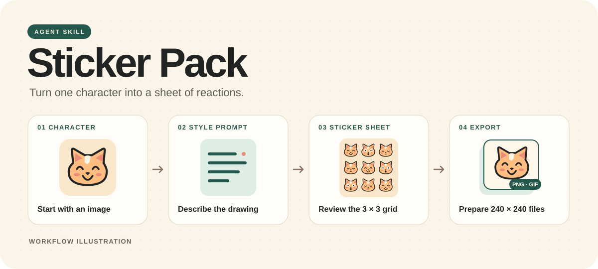

# Sticker Pack · 角色表情包 Skill

把一张角色原图做成可返修的九宫格表情包。从参考画风反推提示词，到逐格裁切、动图提示词和 240×240 GIF 整理。



## 它能做什么

| 功能 | 交付 |
|---|---|
| 反推参考画风 | 拆解轮廓、头身比例、五官、线条、配色、明暗、质感与排字，写成可执行的画法 |
| 设计九宫格 | 每张 9 格，逐格写清情绪、动作、文案和位置，整套复用同一套角色与画风规则 |
| 按格返修 | 按 `02-R2C3` 这样的编号修改指定格，保留其余格的画面与文字 |
| 切图与 GIF | 静态定稿后裁切 240×240 PNG，逐格交付 GIF 提示词。回传的 GIF 可再等比例整理为 240×240 |

正式生成新图只需要**角色原图和一条完整提示词**。风格参考图用于分析，其画法会完整写进提示词。没有风格参考时，可以从公开版内置的[文字风格卡](sticker-pack/assets/references/catalog.md)选。

## 快速上手

### Codex

1. 下载仓库或 Release 的 ZIP，解压。
2. 把整个 `sticker-pack` 文件夹放入项目的 `.agents/skills/`。想跨项目调用时，可以放到个人的 `~/.agents/skills/`。
3. 在 Codex 里选择 `$sticker-pack`，附上角色原图并发送需求。

也可以在 Codex 里调用 `$skill-installer`，把本仓库下 `sticker-pack` 目录的 GitHub 地址交给它安装。

### 其他 Agent Skills 宿主

将同一个 `sticker-pack` 文件夹放进宿主支持的技能目录，或按宿主的技能导入方式加载。宿主需要能查看角色图和风格参考图。Skill 默认交付可复制提示词。Codex 提供内置生图时，可以继续生成静态母图。

### 一条起步指令

```text
用这张狗狗原照做 1 张 1:1 的 3×3 九宫格。
用粗线色块风，做日常聊天表情，透明底。
请拟简体中文短句，先给逐格方案和生图提示词。
```

只上传原图也可以。Skill 会询问缺失的画风、场景、配字、张数和静态背景，再继续设计。

## 从静态到动图

1. 生成静态母图并审阅。局部返修时，用当前母图和该格的编辑提示词。
2. 全套静态定稿后，按实际格线切成 240×240 PNG。单独确认 GIF 背景，再给每格一条同编号的动图提示词。
3. 将单格 PNG 和提示词交给自选平台生成 GIF。回传成品后，可选整理尺寸并打包。

批量切图和尺寸整理使用 **Python 3.9+、Pillow 10+**。240×240 是默认交付尺寸。目标平台有文件体积或审核要求时，按该平台要求准备。

## 仓库内容

- [`SKILL.md`](sticker-pack/SKILL.md) 定义完整工作流。
- [`references/`](sticker-pack/references) 包含参考分析、静态和 GIF 提示词模板，以及交接与导出说明。
- [`scripts/`](sticker-pack/scripts) 提供切图和 GIF 处理脚本。
- [`docs/workflow.svg`](docs/workflow.svg) 是本仓库的原创流程示意图。
